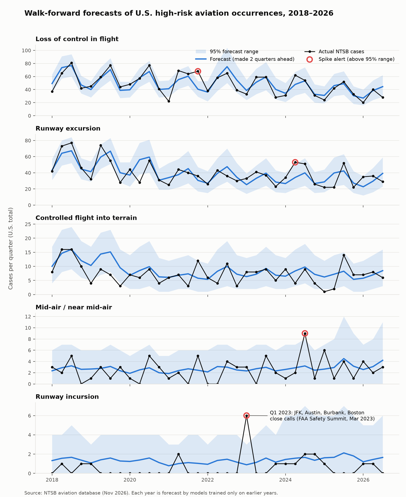
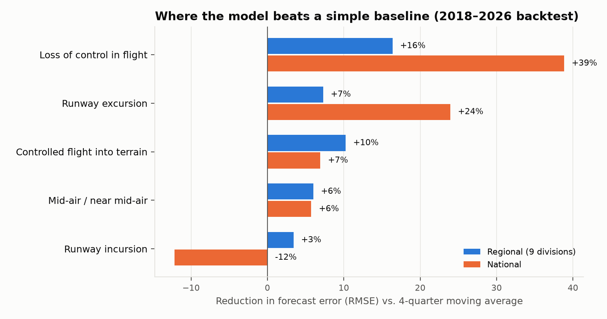

# Forecasting U.S. High-Risk Aviation Occurrences with Near-Miss Precursors (v2)

*Khadidiatou Datt Dia, MS Information Systems & AI, Johns Hopkins University*

This is a public-data demonstration of the precursor-based forecasting method Khadidiatou Dia built for the UN Aviation Safety Section, applied to U.S. aviation. It combines NTSB accident and incident records with NASA ASRS voluntary near-miss reports.

**Status (24 Nov 2026):** v2 runs end to end. It uses NTSB data for 2008–2026 (about 25,500 U.S. cases) and NASA ASRS for January 2009–November 2026: 14,281 near mid-air (NMAC), airborne conflict and runway incursion reports.

## Pipeline
| Step | Script | What it does |
|---|---|---|
| 1 | `src/extract.py` | Pulls NTSB `avall.mdb` into compact CSVs (needs `brew install mdbtools`) |
| 2 | `src/build_panel.py` | Builds 9 U.S. Census divisions × 5 ICAO high-risk categories × quarter: mid-air (MAC), runway incursion (RI), runway excursion (RE), loss of control in flight (LOC-I) and CFIT. Zero-filled, with the incomplete quarter excluded. Adds NTSB precursors (coded occurrences, findings, conditions, negation-aware narrative keywords, TF-IDF+NMF topics fit only on data from 2017 and earlier) and **ASRS precursors** (division and national counts of NMAC, airborne conflict, runway incursion, helicopter and TCAS-RA reports, plus growth). Every feature uses a **two-quarter lag** to avoid look-ahead leakage. |
| 3 | `src/nlp.py` | Negation scrubber ("no evidence of fuel exhaustion" is not a fuel problem) |
| 4 | `src/model.py` | Walk-forward backtest for 2018–2026, where each year is predicted only from earlier years. Ensemble of a Poisson GLM, a Poisson gradient-boosting model and a random forest. Compared against moving-average and seasonal baselines and three ablations. Produces negative binomial 95% intervals, spike alerts, permutation importance and a Q4 2026–Q1 2027 forecast. |
| 5 | `src/report.py` | Figures |
| 6 | `src/dca_lookback.py` | Public ASRS reports of helicopter conflicts at DCA before the January 2025 collision |

## Results (walk-forward, 2018–2026)
**Main model: history + ASRS near-miss precursors.** RMSE reduction versus a 4-quarter moving average:

| Level | All | LOC-I | RE | CFIT | MAC | RI |
|---|---|---|---|---|---|---|
| Regional | 12.1% | 16.4% | 7.3% | 10.2% | 6.0% | 3.4% |
| National | **30.6%** | 38.8% | 23.9% | 6.9% | 5.7% | −12.2% |

**Ablation: does each data source add value?** National RMSE; lower is better.

| Version | MAC | RE | CFIT | LOC-I | RI |
|---|---|---|---|---|---|
| Moving-average baseline | 2.100 | 13.03 | 3.79 | 15.27 | 1.29 |
| History only | 2.047 | 10.47 | 3.73 | **8.43** | **1.40** |
| History + NTSB accident precursors | 2.049 | 10.84 | 3.83 | 9.34 | 1.52 |
| **History + ASRS near-miss precursors** | **1.979** | **9.91** | **3.53** | 9.34 | 1.45 |
| All features | 2.017 | 10.48 | 3.62 | 9.10 | 1.52 |

**Honest reading:**
- **Near-miss reports (ASRS) improve forecasts of mid-air, runway excursion and CFIT occurrences.** Precursors drawn from accident records do not; they slightly hurt. This is consistent with the NTSB's conclusion on the DCA collision: the warning signs are in near-miss data, not in past accidents.
- Effects are modest (about 3–7% beyond history), and the national series has only 35 test quarters. They are encouraging, not definitive.
- For **loss of control**, history alone is best.
- **Runway incursion accidents** (39 NTSB cases) are too rare to forecast. A better target would be the FAA runway incursion database (Category A–D events), which was offline during this build.
- **Intervals:** negative binomial 95% intervals, with dispersion estimated only from earlier years, cover **93%** of national outcomes.

## Spike alerts
Four national quarters came in above their 95% forecast range. The clearest is **runway incursions in Q1 2023**: 6 NTSB cases against about 1 expected.
- The six cases are close calls at JFK (Jan 13), Honolulu (Jan 24), Austin (Feb 4), Sarasota (Feb 17), Burbank (Feb 23) and Boston (Feb 27).
- That cluster led the FAA to convene its Aviation Safety Summit in March 2023.
- The alert marks an abnormal quarter once its data is in. It is spike detection, not advance prediction.

## DCA look-back
NASA's public ASRS database holds **13 reports of helicopter conflicts at or near Reagan National between 2010 and 2024; 6 are coded as near mid-air collisions** (`outputs/dca_helicopter_reports_pre_collision.csv`). Examples:
- 2013: an A320 airborne conflict with a military helicopter at 900 ft on the River Visual approach.
- 2015: two NMACs with helicopters on approaches to DCA. One crew said the tower's traffic call "came too late."
- April 2024: an NMAC with a helicopter on a visual approach, with a TCAS alert.

Public ASRS is only a fraction of the reporting the NTSB reviewed (more than 18 close-call reports a year near DCA across all voluntary systems). Even so, the pattern was visible in public data before the January 29, 2025 collision. This approach is designed to surface that kind of signal. It does not claim the accident would have been prevented.





## Outputs
`outputs/`: `metrics.csv`, `backtest_national.csv`, `backtest_division.csv`, `spike_alerts.csv`, `feature_importance.csv`, `forecast_next_quarters.csv`, `summary.json`, `dca_helicopter_reports_pre_collision.csv`, `figures/`.

## Reproduce
Raw data are not stored in this repository because of their size. Download them from the public sources below into `data/raw/` (NTSB `avall.zip`) and `data/raw/asrs/` (ASRS exports). The processed panel (`data/processed/`) and all outputs are included.
```
pip install -r requirements.txt
python src/extract.py && python src/build_panel.py && python src/model.py && python src/report.py && python src/dca_lookback.py
```
ASRS exports: NASA ASRS Database Online. Event Type = Airborne Conflict, NMAC or Ground Incursion Runway, exported in batches of fewer than 5,000 reports into `data/raw/asrs/`.

Data: NTSB aviation database (public, data.ntsb.gov/avdata, file dated 1 Nov 2026); NASA ASRS Database Online (public, exported 24 Nov 2026).
